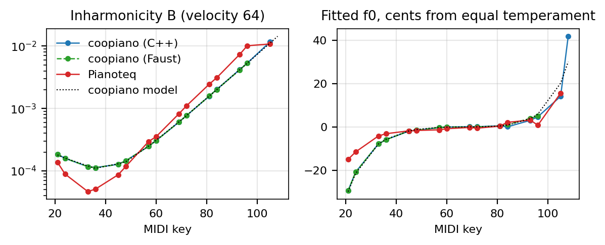
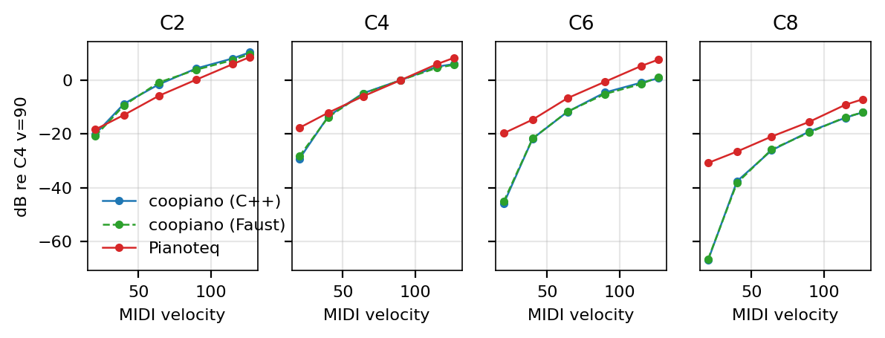
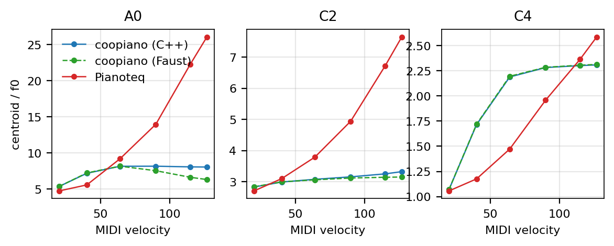
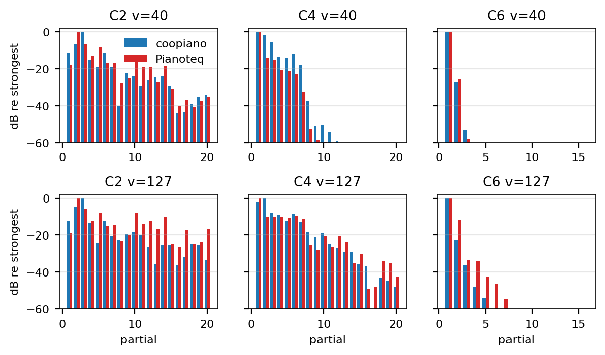
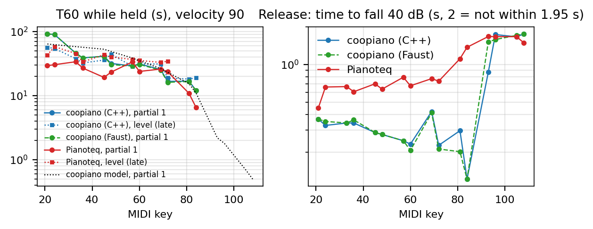
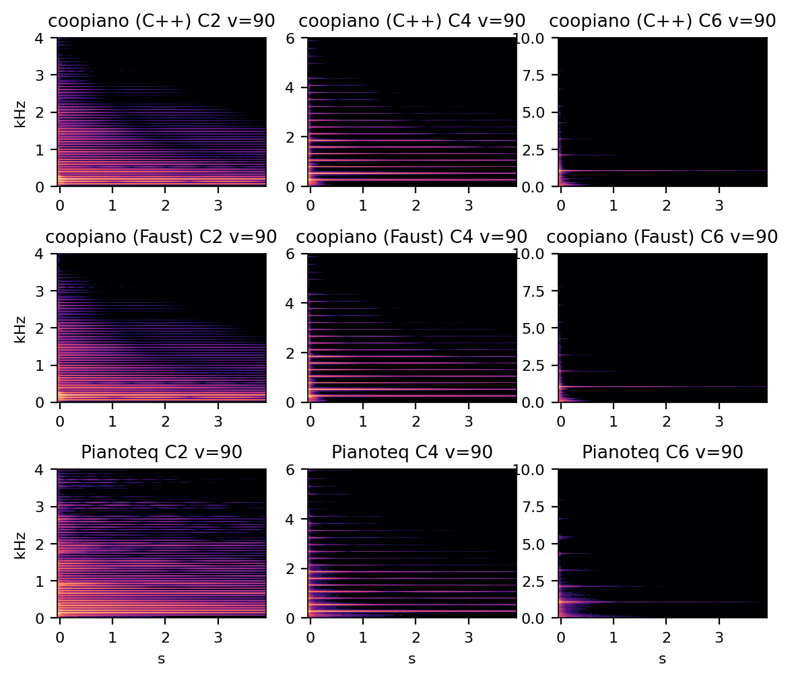

# coopiano against Pianoteq

[Version française](README.fr.md)

Measurements of coopiano (the C++ model this repository ports to Faust), of its
Faust port and of Pianoteq 9, on the same scores, rendered offline and dry. Full
numbers: [`results.txt`](results.txt). Scripts: `scripts/pianoteq_*.py|sh`
(see "Reproduce").

Pianoteq is not a reference piano: it is another physical model, a closed one.
A difference therefore says where the two models make different choices, not
which one is right. Where a judgement would need a real piano, this document
says so.

## In short

| | coopiano | Pianoteq | |
|---|---|---|---|
| Dynamic range v=20 → 127, A0–C4 | 25–35 dB | 26–29 dB | comparable |
| Dynamic range v=20 → 127, treble (A5–C8) | 46–55 dB | 24–30 dB | coopiano's soft treble is nearly silent |
| Brightness with velocity | levels off near v=64 | grows up to 127 | coopiano's fortissimo bass stays dark |
| Inharmonicity B, bass (A0–C3) | 1.2–2.5 × Pianoteq | | |
| Inharmonicity B, treble (A3–C7) | | 1.2–1.9 × coopiano | |
| Stretch tuning, A0 | −30 cents | −15 cents | middle and treble alike |
| T60 of the fundamental, middle (A3–A4) | 25–31 s | 24–34 s | comparable |
| T60 of the fundamental, lowest bass (A0, C1) | ~90 s | ~30 s | |
| Dampers: time to fall 40 dB | 0.2–0.4 s | 0.5–0.8 s (1.1–1.4 s at A5–C6) | |
| Pedal: halo of the freed strings | | 17–25 dB stronger | |
| Stereo on music | correlation 0.44, −1.4 dB in mono | 0.43, −1.5 dB | same |
| Offline rendering, this machine | 6–8 × real time | 12–36 × | Pianoteq 2–5 × faster |

The Faust port reproduces the C++ on all these measures: median differences of
0.5 dB in level, 0.3 % in brightness, 0.1 % in inharmonicity and under 3 % in
decay. One difference remains, with a known cause: the end of a damping with the
pedal up (§ 8). The one at A0 and C1 fortissimo (up to +6 dB) came from a missing
bound on the phantom partials; the bound is now ported.

## What is compared

- **coopiano**: the original C++ program (`../../coopiano`, commit `bba9e06`),
  reverb off (`GP_NO_REVERB=1`), velocity = MIDI / 127 as in its MIDI-file
  rendering. One change only: its WAV writer outputs 32-bit floats instead of
  16-bit integers (`scripts/coopiano_float_wav.py`, see "In passing" below). The
  per-file normalization (peak at 0.89) is kept: only relative levels mean
  something.
- **The Faust port** of this repository: the voice and the body compiled to C++
  by faust-rs and played by `tools/render.cpp` (`make render`, 16 voices), on
  the same events as the MIDI files (`X.score` next to `X.mid`, velocity
  MIDI / 127), with `control 0 reverb/mix 0` for a body without reverb. Its
  curves are dashed green in the figures.
- **Pianoteq 9.2.5, trial version**, preset "NY Steinway D Classical" with its
  reverb, its delay (effect 1) and its limiter switched off
  (`scripts/pianoteq_preset.sh`, through Pianoteq's JSON-RPC server). Its
  equalizers and its four-microphone mix are kept: they are part of the preset's
  sound. The trial locks the physical parameters (not changed here) and mutes
  eight black keys (F#2 G#2 A#2 C#6 D#6 F#6 G#6 A#6); the measured keys are Cs
  and As, all of them played.
- **Same scores** (`scripts/pianoteq_midi.py`):
  - `notes.mid`: sixteen keys (the Cs and As from A0 to C8), six velocities
    (20 to 127), held 5 s;
  - `decay/`: the same keys at v=90, held 15 s, one per file;
  - `pedal.mid`: a staccato note, pedal up then down;
  - `demo.mid` (coopiano's demo) and `prelude.mid` (Bach, BWV 846, bars 1–11),
    for stereo and listening.

  All render at 44.1 kHz, Pianoteq through `--headless --midi … --wav …`.

Every measure is taken on the power of the two channels summed, so that
Pianoteq's spaced microphones do not carve comb filters into a mono sum.
**Validation of the method**: on coopiano, whose model is known, the estimator
recovers each key's inharmonicity B within 5 % from A0 to A7, and its detuning
within 1 cent up to C6 (fig. 1, dotted).

## Results

### 1. Inharmonicity and tuning



The two curves have the same shape: a dip in the bass (around A1–C2), then a
steady rise towards the treble. But coopiano's bass strings are stiffer (B 1.2 to
2.5 times Pianoteq's from A0 to C3), and its treble strings less stiff (Pianoteq
1.2 to 1.9 times more from A3 to C7). The stretch tuning follows: coopiano goes
down to −30 cents at A0, Pianoteq to −15; in the treble both rise together
(+15 cents at A7). Which one is closer to a real Steinway D, these measurements
do not say.

### 2. Dynamics



From A0 to C4, both cover 25 to 35 dB from v=20 to v=127. Pianoteq keeps that
range across the keyboard (24 to 31 dB). coopiano's widens towards the treble:
46 dB at A5, 55 dB at C8, where the softest note is 67 dB below middle C at v=90
(Pianoteq: 31 dB below).

coopiano's hammer data (`build/ref/strike.txt`) give a likely reason: at
velocity 0.17, the felt stays on the string 0.62 ms at C8, 2.6 periods of the
note, and 2 ms at C6, 2 periods. A pulse longer than the period hardly excites
the fundamental any more. Pianoteq visibly shapes its response to keep the
treble playable softly. coopiano's velocity → hammer speed law (6 m/s × v^1.8,
`[hammer] maximum_velocity_mps` and `velocity_exponent` in `default.ini`) is one
lever; when playing live, `GP_VEL_GAMMA` already acts before it.

### 3. Brightness



Spectral centroid of the first 0.2 s, in multiples of the fundamental.
Pianoteq's grows from pianissimo to fortissimo (A0: from 4.8 to 26; C2: from 2.7
to 7.6; C4: from 1.1 to 2.6). coopiano's stops near v=64 (A0: 8; C2: 3.2; C4:
2.3). Above that, the note gets louder without getting brighter.

The hammer explains this too: at C2 the contact lasts 3.41 ms at velocity 0.52
and still 3.13 ms at 1.0, while the peak force grows fivefold. The pulse no
longer shortens, so the spectrum no longer widens. In the next figure, at C2
fortissimo, Pianoteq keeps its partials 10 to 20 between −8 and −26 dB below the
strongest, coopiano between −19 and −36 dB.



### 4. Decay and dampers



Both have a two-stage decay (fast, then slow). In the middle register the times
meet: T60 of the fundamental 31 and 24 s at C4, 25 and 26 s at A4. coopiano's
lowest fundamentals ring much longer (A0 and C1: about 90 s, against 30 s for
Pianoteq). They even outlast the value the model gives them (63 s), perhaps
through their coupling to the other strings and to the board (not verified).
Partials 2 to 4 are closer. All these values are slopes fitted over 15 s, beats
included: read them as orders of magnitude above 30 s.

coopiano's dampers act faster: 0.2 to 0.4 s to lose 40 dB, against 0.5 to 0.8 s
for Pianoteq, and 1.1 to 1.4 s at A5–C6. Above the last dampers (F6 for
coopiano, G6 for Pianoteq), both die away on their own, in 0.9 to 1.8 s.



### 5. Pedal and sympathetic resonance

A staccato note (v=90, released after 0.15 s), pedal up then down:

| key | tail 1–4 s, pedal up | tail, pedal down | halo, pedal down |
|---|---|---|---|
| C2 | −74.9 / −54.1 dB | −9.5 / −10.5 dB | −47.3 / −28.6 dB |
| C3 | −78.3 / −55.2 | −14.3 / −14.6 | −42.7 / −25.7 |
| C4 | −71.3 / −58.3 | −15.3 / −16.6 | −43.6 / −24.8 |
| C5 | −67.2 / −60.3 | −18.9 / −20.2 | −42.6 / −21.3 |
| C6 | −84.1 / −58.3 | −27.4 / −32.2 | −32.8 / −8.2 |

(coopiano / Pianoteq; tail relative to the attack.)

With the pedal down, both sustain the note equally. The "halo" is the energy at
the fundamentals of the keys that are not partials of the note: the strings the
pedal frees and the board sets ringing. It is 17 to 25 dB stronger in Pianoteq.
With the pedal up, coopiano's damped note is also much quieter (−67 to −84 dB
against −54 to −60): Pianoteq lets more resonance linger.

### 6. Stereo

On music the two images are equivalent: L/R correlation 0.44 and 0.43 on the
prelude, and 1.4 and 1.5 dB lost when summing to mono. Note by note, coopiano
puts the bass on the left (+2 dB) and the treble on the right (−5 to −7 dB), as
the pianist hears it. The microphone mix of Pianoteq's "Classical" preset stays
near the centre, with differences from key to key.

### 7. Cost

Rendering offline on this machine (Apple M5), both nearly on a single core,
Pianoteq runs 36 times faster than real time on single notes and 12 to 17 times
on music (its start-up, about 0.8 s, included). coopiano runs 6 to 8 times
faster than real time. Pianoteq is thus 2 to 5 times faster. Most of coopiano's
cost is its soundboard (732 modes, imaged per region) and its sympathetic
register, computed all the time: in real time a voice costs 3 % of a core and
the body 36 to 40 % (`results/cost.txt`).

### 8. The Faust port against the C++

Each measure above, taken on the Faust port as well (`results.txt`, § 8:
largest difference, where, and median):

| measure | median difference | largest difference |
|---|---|---|
| inharmonicity B | 0.10 % | −1.2 % (A6) |
| tuning (fitted f0) | 0.07 cent | +1.0 cent (C6) |
| level, 16 keys × 6 velocities | 0.48 dB | +2.4 dB (A0, v=127: draws, see below) |
| brightness | 0.33 % | +26 % (A7, v=115: a centroid below the fundamental, made of action noises) |
| T60 of the level, early / late | 0.6 % / 1.9 % | +4.5 % / +5.7 % (C6) |
| T60 of partials 1 to 4 | 0.4 to 2.7 % | −9 % (partial 3 of C2) |
| release, −40 dB | 0.01 s | +0.6 s (A6, no damper) |
| L − R balance | 0.04 dB | −0.7 dB (C8) |
| pedal down: tail / halo | 0.02 dB / 0.31 dB | +0.2 dB / +0.6 dB |
| pedal up: tail 1–4 s | 16 dB | −26 dB (C2) |
| music: L/R correlation, loss in mono | | 0.438 / 0.444, −1.44 / −1.42 dB |

The first measurement found two differences that the repository's validations
did not see, because they were made at velocity 0.5.

**A0 and C1 fortissimo, fixed.** The port was 1.7 to 5.9 dB louder from v=90 up
(A0: +1.7, +3.0, +5.9 dB at v=90, 115, 127; C1: +3.1, +4.9, +5.8 dB). The cause:
`bound_phantom` had not been ported. The C++ bounds each pair of phantom
partials, once per strike, to 0.65 times the geometric mean of its parents'
amplitudes; without that bound a quadratic phantom outgrows, at fortissimo, the
partials that produce it. The C++ without its bound reproduces the difference at
the bridge within 0.4 dB (A0: +1.7, +1.6, +1.1, +0.7 dB over 0–50 ms, 50–300 ms,
0.3–1 s, 1–2 s; port: +2.1, +1.5, +1.0, +0.7). The bound is now ported
(`_pair_bound`, `_phantom_gains`): at the bridge, A0 and C1 at velocity 1 are
within 0.2 dB of the C++ (two notes added to `make notes`), and the whole
instrument, with the C++ seed's draws, within 0.5 dB. What remains here (at most
+2.4 dB, unrelated to velocity, +2.0 dB at C1 v=20) comes from the draws: on
these single-string keys the readout spread drawn at each strike (±13 %,
±1.1 dB) is not averaged out, and the two renders draw differently.

**The end of a damping, explained.** With the pedal up, after a staccato note
(0.15 s), both are still together 0.1 s after the release (C4: −29 dB below the
attack). Then, until 1 s, the C++ keeps a component 15 to 25 dB above the port
(C4: −47.5 against −71.5 dB at 0.5 s), and the two meet again by 2 s.

- **It is neither the voice nor the sympathetic register.** At the bridge the
  staccato notes agree within 0.3 dB. In the C++, switching the sympathetic
  register off does not change the tail (within 0.1 dB).
- **It is the soundboard.** The C++ response is at −48, −56 and −72 dB over
  0.3–0.5, 0.5–0.75 and 1–1.4 s (relative to its first 50 ms), 87 % of it
  between 300 Hz and 1 kHz. The port's is at −65, −92 and −158 dB.
- **Where that ring comes from.** Not from the C++ modes, whose T60 is 0.06 to
  0.18 s in that band, but from `flatten_ir`'s minimum-phase equalizer. Designed
  on a 0.34 Hz FFT grid, it lifts three quarters of the board's narrow nulls above
  450 Hz by up to 20 dB. Those narrow peaks ring for about 2 s, until the response
  is cut at 1.4 s.
- **Why the port does not reproduce it.** The modal fit keeps the C++ modes and
  cannot carry that ring. A trial with 16 to 64 resonators fitted to what the fit
  leaves gained only 1 to 2 dB.

The difference therefore remains. It is documented in the README's known
differences; the room reverb masks it for about a second after the release.

On the way, `tools/render.cpp` turned out to ignore velocity: it stored the
controls by label alone, and the velocity's "gain" label was overwritten by
`resonance/gain`'s. Every note of `make render` therefore played at 0.5. It now
keys the controls by path, as the web page does; the cost measured by
`scripts/cost.sh` does not depend on it (3.0 % per voice and 36 to 40 % for the
body, against 3.1 % and the same figures before).

Offline, the port renders 1.6 to 2.5 times faster than real time, against 6 to 8
times for the C++: the C++ plays its soundboard as an impulse response
(partitioned convolution, `streaming_soundboard.hpp`), the port as 732 modal
resonators per channel.

## What to take from it

- **They agree** on the shape of the inharmonicity and of the stretch tuning, on
  the two-stage decays of the middle register, on the stereo image of music and
  on the pedal's sustain.
- **coopiano departs** with a nearly silent soft treble, a brightness that levels
  off at mezzo-forte, a quieter sympathetic halo, faster dampers and bass notes
  that ring longer. The first two have the same likely origin: the hammer's
  contact time, too long in the soft treble and no longer shortening when loud.
  That is where to look first (the felt's stiffness and exponent laws;
  `[hammer] stiffness_scale` and `velocity_exponent` in `default.ini`).
- **The Faust port** carries these differences as they are: against Pianoteq it
  behaves like the C++, except at the end of a damping with the pedal up (§ 8).
- Which one is closer to the truth can only be told with recordings of a real
  piano; the scripts accept any WAV render in Pianoteq's place.

## In passing: coopiano's 16-bit WAV writer

coopiano's offline renderer writes 16-bit integers by truncation, without
dither. A tail that decays into the last bits becomes a nearly square wave, with
exact odd harmonics of its fundamental. On A6 alone, normalized to −1 dBFS, the
3rd harmonic is 34 dB below the fundamental in 16 bits, against 65 dB in float.
On the C6 of a 96-note file these harmonics hid the real partials so well that
the measured inharmonicity fell to zero. Rounding with triangular dither, or
writing floats, would remove the effect; this is a remark for coopiano itself,
not for the port.

## Listening

`scripts/pianoteq_analyze.py` writes into `build/pianoteq/listen/` the prelude
and the demo of each instrument (C++, Faust, Pianoteq), dry (`*_dry_*`) and with
its own room (`*_room_*`: coopiano's reverb, Pianoteq's preset untouched), all at
the same RMS level (−20 dBFS) so that loudness does not decide. These files are
not versioned: they are renders of a Pianoteq trial, and they weigh more than
100 MB.

## Reproduce

```bash
scripts/pianoteq_preset.sh         # once: writes Pianoteq's dry preset
make pianoteq                      # renders (~13 min), then measures and figures
```

`COOPIANO` points to the coopiano repository (default `../../coopiano`),
`PIANOTEQ` to Pianoteq's executable and `PIANOTEQ_FXP` to the preset; rendering
the port needs `build/full/render` (`make render`, hence faust-rs).
